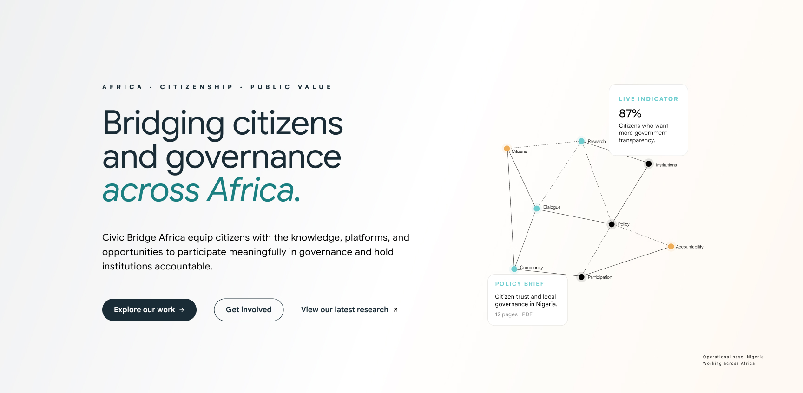
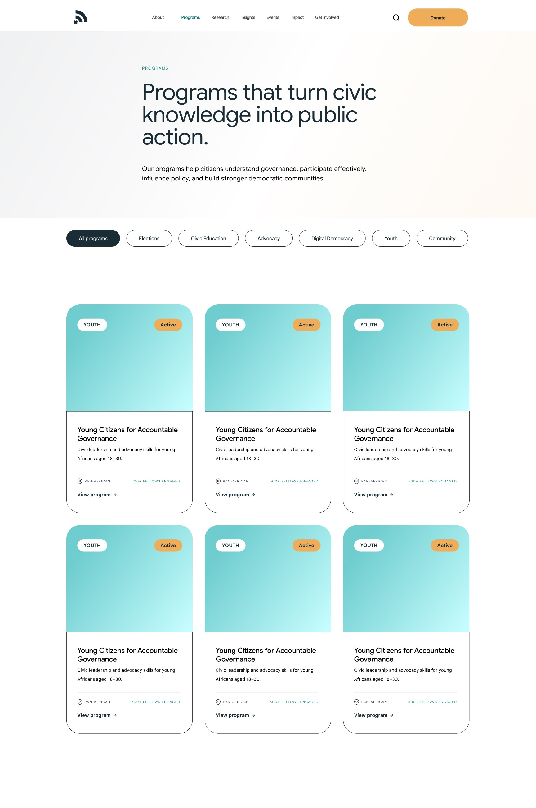
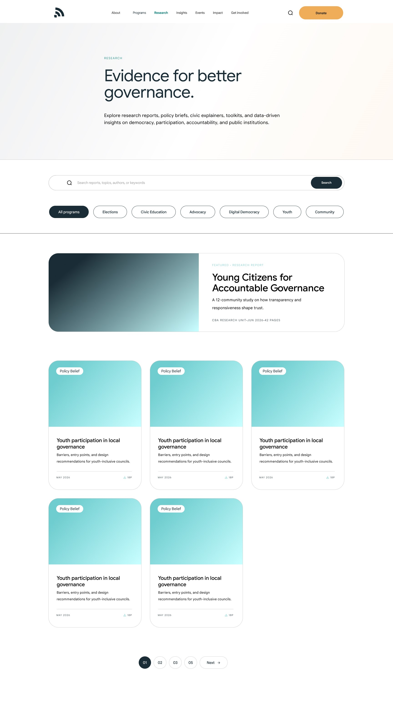
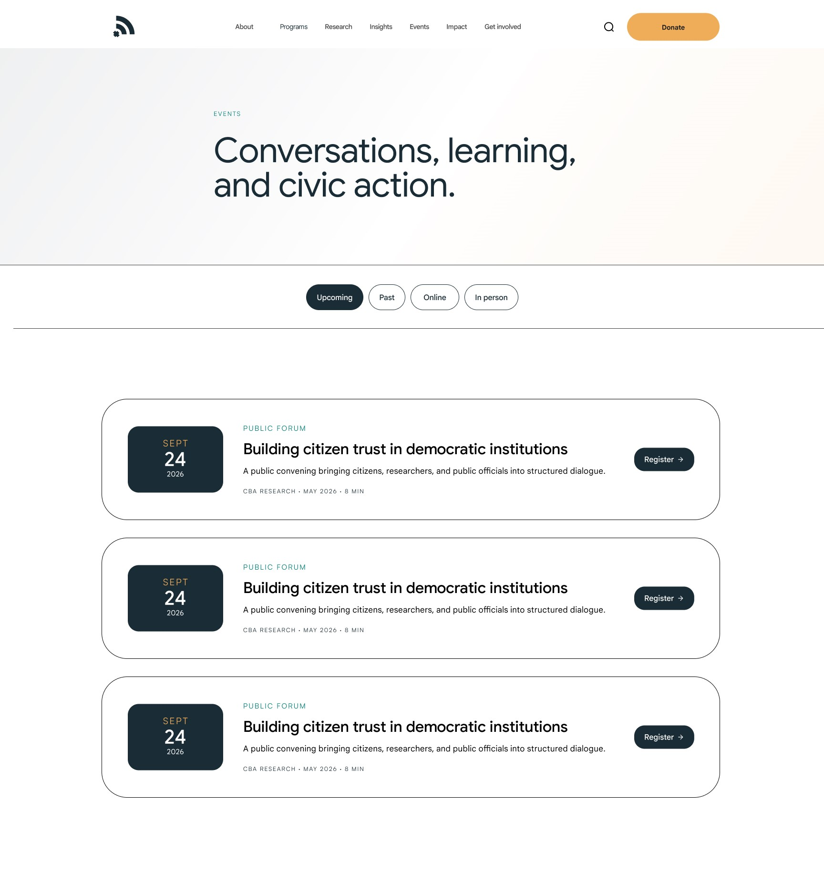
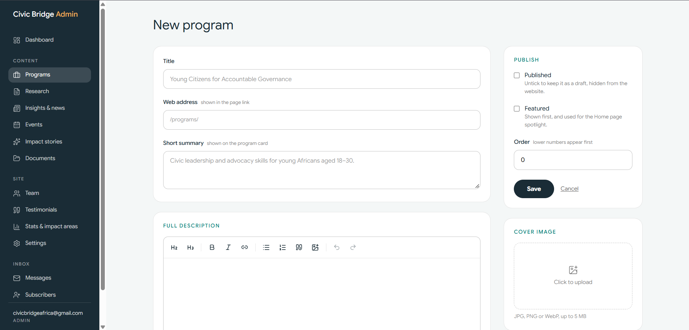
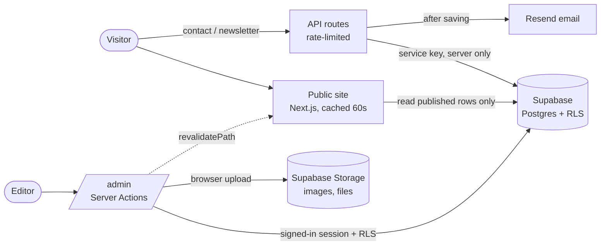

<div align="center">

# Civic Bridge Africa

**A nonprofit civic hub website with a full content admin.**
Pixel-matched to the Figma design, powered by Next.js and Supabase, and fully editable by the team: no developer needed to publish a report, an event or a story.


</div>

---

## Contents

- [Overview](#overview)
- [Screenshots](#screenshots)
- [Features](#features)
- [Tech stack](#tech-stack)
- [How it works](#how-it-works)
- [Project structure](#project-structure)
- [Getting started](#getting-started)
- [Environment variables](#environment-variables)
- [Set up Supabase](#set-up-supabase)
- [Using the admin](#using-the-admin)
- [Content model](#content-model)
- [Security](#security)
- [Deployment](#deployment)
- [Troubleshooting](#troubleshooting)
- [Design notes](#design-notes)
- [Roadmap](#roadmap)
- [Author](#author)

---

## Overview

Civic Bridge Africa is a nonprofit advancing informed participation, accountable leadership and inclusive governance across Africa. This repository contains its complete website:

- an **eight-page public site** replicated from a Figma design, with a detail page behind every card
- a **custom admin dashboard** where staff manage programs, research, articles, events, impact stories, documents, team, testimonials, stats and site settings
- an **inbox** for contact messages and newsletter subscribers, with email notifications
- a custom **404 page**, draft preview, SEO metadata and responsive layouts

Everything on the site that isn't fixed brand copy is stored in Supabase and edited through `/admin`.

## Screenshots

> Add images to `docs/screenshots/` and they will appear here.

| Home | Programs |
|---|---|
|  |  |

| Research | Event page |
|---|---|
|  |  |

| Admin dashboard | Editor |
|---|---|
|  |  |

## Features

### Public website

| Page | What it does |
|---|---|
| **Home** | Hero with an animated-looking network graphic, purpose statement, what we do, a featured-program spotlight, live impact stats, the five-step impact model, latest research, latest insights, the next event, testimonials, get-involved cards and a newsletter signup |
| **About** | Story, vision and mission, six values, five-stage practice, geographic focus with an Africa map, team tiles and public documents |
| **Our team** `/about/team` | Every team member with photo, role and bio |
| **Programs** | Filterable program cards, each opening its own page (`/programs/[slug]`) |
| **Research** | Search, topic filters, a featured report, pagination and PDF downloads (`/research/[slug]`) |
| **Insights** | Articles and news with category filters, a featured article and Load more (`/insights/[slug]`) |
| **Events** | Upcoming and past, online and in-person filters, speakers and registration links (`/events/[slug]`) |
| **Impact** | Editable stats, six impact areas, case studies (`/impact/[slug]`) and annual reports |
| **Get involved** | Volunteer, Partner and Support cards plus a contact form with spam protection |
| **404** | A custom page with a "broken link" network illustration |

Also: per-page titles, descriptions and Open Graph images, a sticky mobile menu, swipeable filters on phones, and `prefers-reduced-motion` support.

### Admin dashboard (`/admin`)

- **Secure sign-in** with Supabase Auth. Public sign-ups are disabled and access is limited to an allow-list.
- **Roles:** `admin` and `editor`.
- **Full content management** for programs, research, insights and news, events, impact stories, documents, team, testimonials, impact stats, impact areas and site settings.
- **Rich text editor** (Tiptap) with headings, lists, links, quotes and inline images.
- **Uploads** straight from the browser to Supabase Storage: images (JPG, PNG, WebP, AVIF, up to 5 MB) and documents (PDF, Word, Excel, up to 25 MB).
- **Draft or publish**, **featured** flags and manual ordering.
- **Draft preview:** view an unpublished item exactly as visitors will, in a clearly marked preview mode.
- **Inbox:** contact messages (new, read, archived) with one-click reply, and newsletter subscribers with **CSV export**.
- **Email notifications** for new messages via Resend, with a test button in Settings.
- **Responsive admin** with a slide-in mobile menu.

## Tech stack

| Layer | Technology |
|---|---|
| Framework | [Next.js 16](https://nextjs.org) (App Router, Server Components, Server Actions) |
| UI | React 19, [Tailwind CSS v4](https://tailwindcss.com), [lucide-react](https://lucide.dev) icons |
| Language | TypeScript |
| Database, auth, storage | [Supabase](https://supabase.com) (Postgres with Row Level Security, Auth, Storage) |
| Rich text | [Tiptap](https://tiptap.dev) v3, rendered through `sanitize-html` |
| Email | [Resend](https://resend.com) |
| Fonts | Google Sans Flex (Google Fonts) and Satoshi (Fontshare) |

## How it works



- **Public pages** are server-rendered and cached, refreshing every 60 seconds. Saving in the admin also refreshes the affected pages immediately.
- **Public reads** use the publishable key and can only ever see rows marked `published`.
- **Writes** from the admin run as the signed-in user and are allowed only by database rules, if that user is on the `admin_users` list.
- **Visitor submissions** (contact and newsletter) are written by server routes using the secret key, never from the browser.

## Project structure

```
civic-bridge/
├── public/images/              Logos and static images
├── supabase/                   SQL scripts (run in order)
├── src/
│   ├── proxy.ts                Protects /admin and refreshes sessions
│   ├── app/
│   │   ├── layout.tsx          Root layout (fonts, global CSS)
│   │   ├── not-found.tsx       Custom 404
│   │   ├── globals.css         Design tokens and rich-text styles
│   │   ├── (site)/             Public website (has header and footer)
│   │   │   ├── page.tsx        Home
│   │   │   ├── about/ (+ team/)
│   │   │   ├── programs/ (+ [slug]/)
│   │   │   ├── research/ (+ [slug]/)
│   │   │   ├── insights/ (+ [slug]/)
│   │   │   ├── events/ (+ [slug]/)
│   │   │   ├── impact/ (+ [slug]/)
│   │   │   └── get-involved/
│   │   ├── admin/              Dashboard (own layout, no site chrome)
│   │   │   ├── login/
│   │   │   └── (dashboard)/    programs, research, insights, events,
│   │   │                       case-studies, documents, team, testimonials,
│   │   │                       stats, settings, messages, subscribers
│   │   └── api/                contact, subscribe, preview
│   ├── components/             ui, layout, home, about, programs, research,
│   │                           insights, events, impact, get-involved, admin
│   └── lib/                    supabase clients, auth, content queries, types,
│                               utils, sanitize, storage, email, rate limiting
└── .env.example
```

## Getting started

### Prerequisites

- Node.js **20.9 or newer**
- A free [Supabase](https://supabase.com) project
- (Optional) a [Resend](https://resend.com) account for email notifications

### Install and run

```bash
git clone https://github.com/dottiebing/civic-bridge.git
cd civic-bridge
npm install

cp .env.example .env.local      # then fill in the values (see below)
npm run dev
```

Open <http://localhost:3000>. The admin is at <http://localhost:3000/admin>.

### Scripts

| Command | What it does |
|---|---|
| `npm run dev` | Start the development server |
| `npm run build` | Create a production build |
| `npm run start` | Run the production build |
| `npm run lint` | Lint the code |

## Environment variables

Copy `.env.example` to `.env.local`. Never commit `.env.local`.

| Variable | Required | Purpose |
|---|---|---|
| `NEXT_PUBLIC_SUPABASE_URL` | yes | Your Supabase project URL |
| `NEXT_PUBLIC_SUPABASE_PUBLISHABLE_KEY` | yes | Public key (safe in the browser) |
| `SUPABASE_SECRET_KEY` | yes | **Server-only** key used by the contact and newsletter routes |
| `NEXT_PUBLIC_SITE_URL` | recommended | Public site address, used in email links |
| `RESEND_API_KEY` | for email | Resend API key |
| `EMAIL_FROM` | for email | Sender, e.g. `Civic Bridge Africa <notifications@yourdomain.org>` |
| `CONTACT_NOTIFY_EMAIL` | optional | Fallback recipient if no contact email is set in the admin |
| `CONTACT_WEBHOOK_URL` | optional | Pinged on each new message (n8n, Make, Zapier) |
| `NEWSLETTER_WEBHOOK_URL` | optional | Pinged on each new subscriber |

Restart the dev server after changing `.env.local`.

## Set up Supabase

1. **Create a project** at supabase.com.
2. **Run the SQL.** In the **SQL Editor**, run these files from the `supabase/` folder, in order:
   1. `01-core-schema.sql`: tables, security rules, storage buckets and starter stats.
   2. `02-program-spotlight-fields.sql`: extra program fields used by the Home spotlight.
3. **Lock down sign-ups.** In **Authentication → Sign In / Providers**, turn **off** "Allow new users to sign up".
4. **Create the first admin.** In **Authentication → Users → Add user**, add an email and password and tick **Auto Confirm User**. Then run:

   ```sql
   insert into public.admin_users (user_id, email, role)
   select id, email, 'admin' from auth.users where email = 'you@example.com';
   ```

5. **Copy your keys** from **Settings → API Keys** into `.env.local`.
6. Sign in at `/admin/login`.

To add more editors, create each person under **Authentication → Users**, then add them to `admin_users` with the role `editor`.

## Using the admin

| Section | Manage | Appears on |
|---|---|---|
| Programs | Cover, summary, rich description, category, status, location, reach, duration, audience | Programs, Home spotlight (featured one) |
| Research | Reports and briefs with PDF upload, cover, author, page count | Research, Home |
| Insights & news | Articles with rich text, category (use *News* for news items) | Insights, Home |
| Events | Date and time, location, format, speakers with photos, registration link | Events, Home (next or featured upcoming) |
| Impact stories | Case studies with cover and story | Impact |
| Documents | Public documents and annual reports (file upload) | About, Impact |
| Team | Photo, role, bio and order | About, Our team |
| Testimonials | Quote, name, role, photo | Home |
| Stats & impact areas | Numbers and the six lenses | Impact, Home (first four stats) |
| Settings | Hero note, footer text, contact email | Home, Footer, Get involved |
| Messages | Contact form submissions, reply by email | n/a |
| Subscribers | Newsletter list, CSV export | n/a |

**Publishing workflow:** save an item as a draft, click **Preview ↗** in its list to see it as visitors will, then tick **Published**.

## Content model

| Table | Purpose |
|---|---|
| `admin_users` | Allow-list of people who may edit (`admin` / `editor`) |
| `programs`, `research`, `insights`, `events`, `case_studies` | Main content, each with a slug, cover image, `published` and (where relevant) `featured` |
| `documents` | Files for the About (`public`) and Impact (`annual`) pages |
| `team_members`, `testimonials` | People and quotes |
| `stats`, `impact_areas` | Editable impact numbers and lenses |
| `site_settings` | Small key/value texts (hero note, footer, contact email) |
| `messages`, `subscribers` | Inbox (admin-only) |

Storage buckets: `images` and `files` (public to read, admin-only to write).

## Security

- **Row Level Security** is on for every table. Visitors can read only `published` rows. Only users listed in `admin_users` can write.
- The **secret key is server-only** (`server-only` import) and used only by the contact and newsletter routes.
- **Admin routes are protected twice:** by the proxy and again inside every page and server action.
- **Rich text is sanitised** on save and on display (`sanitize-html` with a strict allow-list).
- **Uploads are restricted** by type and size at both the app and the storage bucket. SVG is deliberately not allowed.
- **Forms** use a honeypot field and rate limiting. The rate limiter is in-memory per server instance, so add a captcha such as Cloudflare Turnstile if spam appears.
- **CSV export** neutralises spreadsheet formula injection.
- The admin sends `noindex` so it stays out of search results.

## Deployment

The project is built for [Vercel](https://vercel.com):

1. Push the repository to GitHub and import it in Vercel.
2. Add every variable from [Environment variables](#environment-variables) in **Project Settings → Environment Variables**. Set `NEXT_PUBLIC_SITE_URL` to the live domain.
3. In Supabase, set **Authentication → URL Configuration → Site URL** to the live domain.
4. Deploy, then sign in at `/admin/login` on the live site.

For email, verify your domain in Resend (add the DNS records it gives you) so messages avoid spam folders.

## Troubleshooting

| Problem | Likely cause |
|---|---|
| Sign-in says "fetch failed" and pages take 25+ seconds | No internet connection, or the Supabase project is paused. Restore it from the Supabase dashboard |
| "Email not confirmed" or "Invalid login credentials" | Re-create the user with **Auto Confirm User** ticked, then add them to `admin_users` again |
| "Invalid API key" | Wrong key in `.env.local`, or the dev server wasn't restarted after editing it |
| Uploaded images don't show | Check `next.config.ts` allows `*.supabase.co`, then restart the dev server |
| Nothing appears on a public page | The item is still a draft, or wait up to 60 seconds for the cache |
| Admin redirects to `/admin/login?error=forbidden` | The user exists but isn't in `admin_users` |
| `middleware` warning or error | Next.js 16 uses `src/proxy.ts`. On Next 15, rename it to `middleware.ts` and the function to `middleware` |
| Emails don't arrive | Check `RESEND_API_KEY` and `EMAIL_FROM`, use **Send a test email** in Settings, and check spam |

## Design notes

- The site replicates the **Figma designs** (desktop, 1728 px). Spacing, type sizes and colours come from the design files.
- Figma has **no mobile or tablet layouts**, so responsive behaviour is designed to match the desktop language.
- **Detail pages** (program, report, article, event, story, team) and the **404** are not in Figma and were designed from the existing style.
- **Fonts:** Google Sans Flex stands in for the design's Google Sans; Satoshi is loaded from Fontshare.
- **Colour tokens** live in `src/app/globals.css` under `@theme`: navy `#1a2c36`, teal `#1b7f81`, light teal `#6fcdcf`, amber `#efad59`.

## Roadmap

Ideas that are not built yet:

- [ ] User management screen (invite editors without SQL)
- [ ] Media library with unused-file cleanup
- [ ] Scheduled publishing
- [ ] Per-person team pages
- [ ] Captcha on public forms
- [ ] Multilingual content

## Author

Built by **Ayobami Bolade** ([@dottiebing](https://github.com/dottiebing)(https://ayobamibolade.netlify.app)).

## License

Proprietary. Built for Civic Bridge Africa. Contact the author before reusing any part of this project.